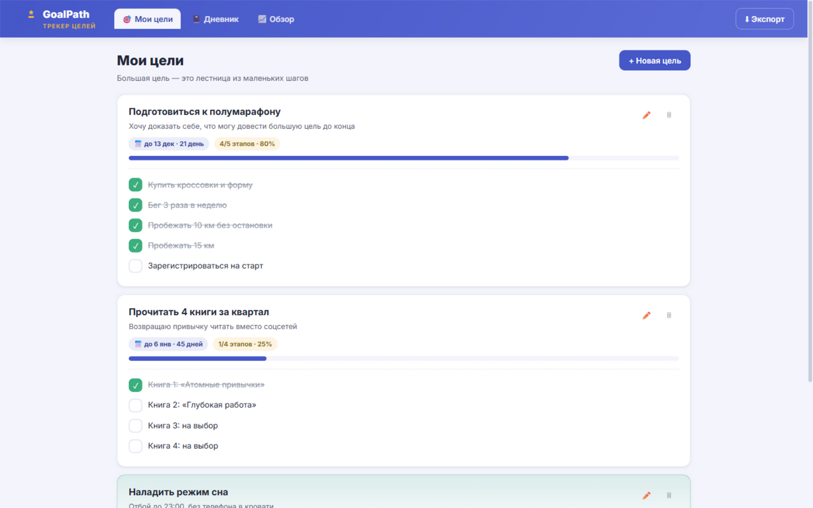

# GoalPath — трекер целей

Трекер целей: большая цель — это лестница из маленьких шагов. Цели разбиваются на этапы, прогресс виден наглядно.

## Скриншоты



## Задача

Помочь довести большую цель до конца: разбить её на этапы, отслеживать прогресс и фиксировать результаты в дневнике.

## Функции

- Цели с дедлайнами и этапами (чек-лист шагов)
- Прогресс-бары и процент выполнения по каждой цели
- Дневник и обзор по всем целям
- Экспорт данных
- Сохранение данных в браузере (localStorage)

## Как запустить

Открыть `index.html` напрямую или через локальный сервер:

```bash
python -m http.server 8080
```

Есть Dockerfile для контейнеризации.

## Стек

- HTML/CSS/JS (ванильный)
- localStorage для хранения данных
- Docker
